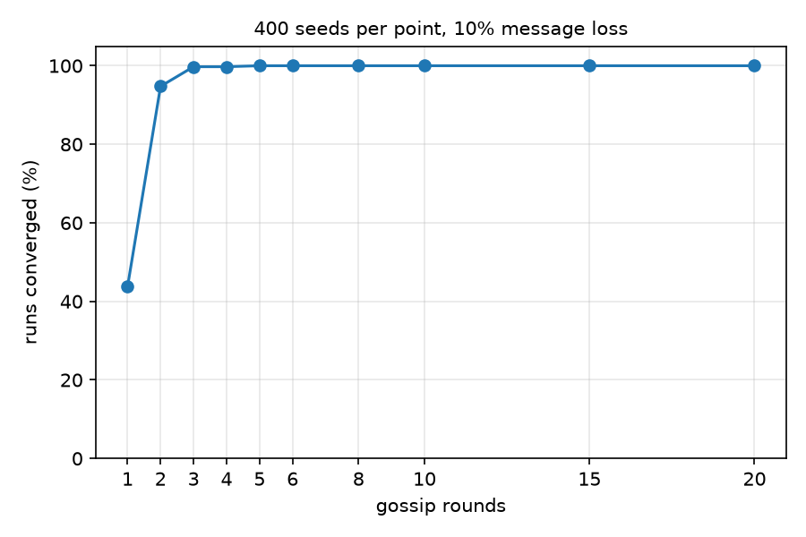

<!-- SPDX-License-Identifier: Apache-2.0 -->
# Gossip rounds in memory_concurrent_writers

Scenario: `memory_concurrent_writers`. Changed `task.config.rounds` from 20 to 5.

## Why this setting

In this scenario eight agents each keep their own copy of the same value, all write to it at once, and then
spend a fixed number of rounds gossiping their copy to everyone else while 10% of messages
get dropped. Conflicts are settled by a merge rule that
guarantees everyone ends up on the same value.

The merge rule takes care of correctness on its own, but it
only promises the copies agree *eventually*. How soon that happens depends on how much the
agents "gossip", i.e. share their copy.

`rounds` is how much they gossip. Each one is a broadcast from all 8 agents, which on real
hardware costs bandwidth and battery, so it is a genuine trade-off. It's also the kind of number
that tends to get set by whatever felt safe, since measuring it on a live system is
awkward. I wanted to actually measure it.

20 rounds for 8 agents looked generous, so the question is how much of it does real work.

I picked this setting because the direction of the effect of having less rounds was obvious but the number of rounds necessary wasn't. Fewer rounds has to break convergence eventually.

Message loss is random, so convergence at a given round count is a rate, and one run tells you nothing. Thus, every number below is over 400 seeds.

## Result

Baseline at seed 42 converges, both validators pass. At `rounds: 5` it also converges,
both validators pass, but with 45 broadcasts instead of 154 and 266 deliveries instead of
1064.

400 seeds per row:

| rounds | converged | failed | max distinct values | worst left behind |
|---:|---:|---:|---:|---:|
| 1 | 43.8% | 225 | 4 | 4 |
| 2 | 94.8% | 21 | 2 | 2 |
| 3 | 99.8% | 1 | 2 | 1 |
| 4 | 99.8% | 1 | 2 | 1 |
| 5 | 100.0% | 0 | - | - |
| 6, 8, 10, 15, 20 | 100.0% | 0 | - | - |



5 is the cheapest setting that never failed in 400 seeds, so the default is about 4x more
syncing than needed. 

I assumed cutting rounds would give me the same failure more often. However, it also changes how
bad the failure is.

To check it I recorded, for each failed run, how the 8 replicas split
across the values they ended on, instead of just pass or fail. The last two columns above
are that. At one round the group could end up holding 4 different values at once, and 74 of
the 225 failures left two or more replicas behind. One run finished 4-4, an even split with
no majority at all. At two rounds no run produced more than two values and the worst case
was two replicas behind. At three rounds every failure was a single straggler.

So more gossip rounds lead to fewer failures, and smaller ones.

## Reproducing

```bash
uv sync
uv run nest run scenarios/memory_concurrent_writers.yaml -o traces/mcw_baseline.jsonl
uv run nest run examples/crdt-gossip-rounds/scenario.yaml -o traces/mcw_rounds5.jsonl

# table above plus results.png, 400 seeds per point, ~80s
uv run --with matplotlib python examples/crdt-gossip-rounds/experiment.py 400
```
